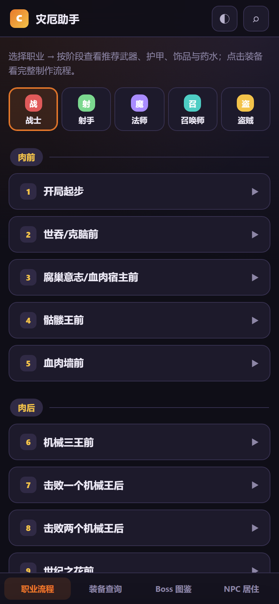
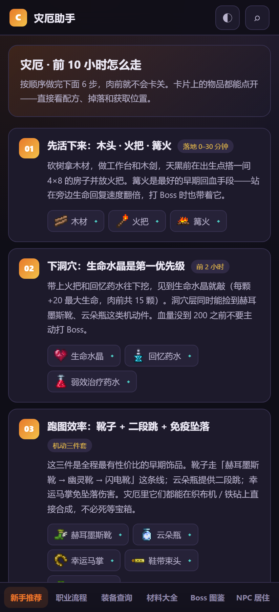
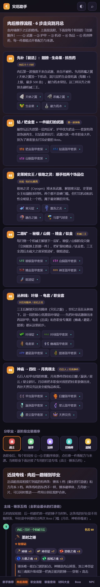
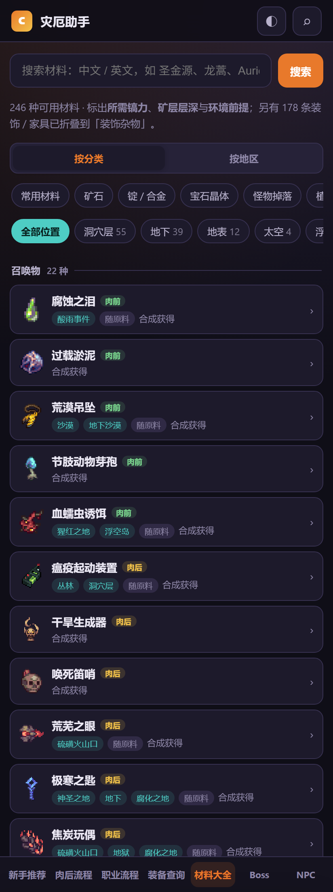

# 灾厄助手 · Calamity Guide

> 泰拉瑞亚 **灾厄模组（Calamity Mod）** 的离线攻略助手 —— 一整个 App 压成 **单个 HTML 文件**，双击就开，手机上也能用，全程不联网。

**🌐 在线直接用** <https://essesky.github.io/calamity-guide/> ｜ **📥 下载单文件** [灾厄助手.html](灾厄助手.html)

<p>
  
  
  
  
  
</p>

<p align="center">
  
</p>

---

## 这东西解决什么问题

灾厄把泰拉瑞亚的装备树做大了一个数量级：一件毕业武器往回追，往往要穿过 **好几个 Boss 的掉落物 → 锭 → 矿** 的链条，而 wiki 是英文的、按物品分页的，查一条链要点开十几个标签页。

这个工具把它压平成两条主线：

- **按阶段看**：从开局到月后，每个 Boss 前该拿什么武器、什么甲、什么饰品；
- **按物品追**：点任意一件装备，一路往下追到「这个矿在哪个层、要多少镐力、有什么前置条件」。

所有数据来自官方 wiki 的 Cargo 数据库与中文本地化语言包，**离线烧进 HTML**，所以在没有网络的飞机上、在床上关灯的手机上都能查。

---

## 功能

| 模块 | 内容 |
| --- | --- |
| **新手推荐** | 6 步开局路线 + 肉前 Boss 顺序 + 3 条铁律（防腐化、别乱砸祭坛、先做床） |
| **肉后流程** | 6 张流程卡，从砸祭坛一路排到月总，含每个阶段的装备换代节点 |
| **职业流程** | 战士 / 射手 / 法师 / 召唤 / 盗贼 **五职业专线**，每职业 5~8 档，武器带完整打造链 |
| **装备查询** | 3174 件物品，支持中文名 / 英文名 / 别名搜索，显示伤害、效果、配方、升级去向 |
| **材料大全** | 428 条材料，按分类或按地区浏览；矿石标注**镐力门槛 / 矿层层深 / 环境风险** |
| **Boss 图鉴** | 53 个 Boss，按阶段排序，含召唤物与掉落 |
| **NPC 居住** | 26 个 NPC 的入住条件与偏好 |

其它细节：

- **任意原料可点**：配方里的每一项都能继续展开，直到追到"靠掉落"或"靠挖矿"为止；
- **地层剖面**：矿石详情里有一条五段竖条（太空 → 地表 → 地下 → 洞穴 → 地狱），目标层高亮并标 y 值；
- **零依赖**：3227 张图标全部 base64 内嵌，无 CDN、无字体外链、无 fetch；
- **深色 UI**：为夜里躺着查设计，412 px 宽度下不换行、不横向滚动。

---

## 快速开始

### 在线使用（零安装）

打开 **<https://essesky.github.io/calamity-guide/>** 即可，手机浏览器用同一个地址。

这是 GitHub Pages 托管的静态页面，内容与下面的单文件版**逐字节相同**（来自同一份构建产物，md5 一致）。首次加载 3.26 MB，之后走浏览器缓存。

### 下载单文件（离线用，推荐）

下载 [`灾厄助手.html`](灾厄助手.html)，双击用浏览器打开即可。

- 手机上：把文件发到微信 / QQ 自己，用浏览器打开；iOS 可「添加到主屏幕」，安卓 Chrome 可「添加到主屏幕」，之后像 App 一样全屏运行。
- 全程离线，删掉文件即卸载。

### 自己构建

只需要 Python 3.9+，无第三方依赖：

```bash
python src/build_html.py
# 输出：./灾厄助手.html
```

构建是可复现的 —— 同一份数据重新构建应当得到完全相同的文件：

```
md5  3ce8c68f9519e4b00c90615cd27e9a6e   灾厄助手.html
```

---

## 更多截图

<table>
<tr>
<td width="50%"><br><sub>新手推荐：开局 6 步</sub></td>
<td width="50%"><br><sub>职业流程：战士专线逐档打造链</sub></td>
</tr>
<tr>
<td><br><sub>材料详情：熔炼 → 开采前提 → 地层剖面</sub></td>
<td><br><sub>Boss 图鉴：按阶段排列</sub></td>
</tr>
</table>

---

## 数据从哪来

| 数据 | 来源 | 规模 |
| --- | --- | --- |
| 物品 / 配方 | `calamitymod.wiki.gg` Cargo API（`Recipes`、`Items` 表） | 3174 件物品 |
| 原版配方兜底 | `terraria.wiki.gg` 中文站 | 3411 条目 / 3942 条配方 |
| 中文译名 | 游戏官方语言包 `.Items.json` | 8416 条译名 |
| 图标 | 两个 wiki 的 `imageinfo` 接口 | 3227 张（PNG / GIF） |
| 镐力 / 层深 | 各矿物 wiki 页 `pickreq` 字段与正文 | 32 种矿 |

**可信度分级**（构建时按这个顺序取值，避免"凭印象"补数据）：

1. Cargo 数据库的结构化字段 —— 最高；
2. wiki 正文里的明确句子（"requires at least a Cobalt Pickaxe"）—— 次之；
3. 社区常识 —— 只在 1、2 都查不到时使用，并在界面里标注。

数据快照时间：**2026-11-26**。游戏版本更新后需要重新跑抓取脚本（见下）。

---

## 目录结构

```
calamity-guide/
├── 灾厄助手.html              ← 成品，单文件 App（3.26 MB）
├── README.md
├── LICENSE
├── docs/screenshots/          ← README 配图
└── src/
    ├── build_html.py          ← 构建入口：模板 + 数据 → 单文件 HTML
    ├── app_template.html      ← 前端模板（HTML/CSS/JS 全在这里，含注入占位符）
    ├── app_data_final.json    ← 物品主数据：配方、阶段、升级去向
    ├── materials.json         ← 材料大全：分类、位置、开采前提
    ├── vanilla_recipes.json   ← 原版配方兜底
    ├── vanilla_final.json     ← 原版获取方式（掉落 / 开箱 / 购买）
    ├── newbie.json            ← 新手推荐页内容
    ├── hardmode.json          ← 肉后流程页内容
    ├── melee.json / ranger.json / magic.json / summon.json / rogue.json
    │                          ← 五职业专线数据
    ├── icon_alias.json / zh_alias.json   ← 图标与中文名别名表
    ├── images/                ← 3227 张图标（构建时 base64 内联）
    ├── zh_hjson/              ← 官方语言包片段（译名来源）
    └── *.py                   ← 数据抓取与订正脚本（见下）
```

### 脚本分工

| 前缀 | 作用 |
| --- | --- |
| `build_*.py` | **构建主流程**：`build_html.py` 出成品；`build_data.py` / `build_vanilla.py` 生成主数据 |
| `fetch_*.py` | 从 wiki / 语言包抓原始数据（配方、物品、图标、镐力、译名…） |
| `fix_*.py` / `add_*.py` | 数据订正与补录，按时间顺序执行，保留下来作为**数据变更记录** |
| `make_package.py` | 打包源码 zip |

> `fetch_*.py` 需要外网访问 wiki，且调用频率需克制（wiki 有速率限制）。`build_html.py` 完全离线。

---

## 构建原理

`app_template.html` 是一份可以直接运行的完整前端，里面留了 8 个占位符：

```js
const DATA  = /*__DATA__*/;      // 物品主数据
const MATS  = /*__MATS__*/;      // 材料大全
const VANS  = /*__VANS__*/;      // 原版获取方式
const IMG   = /*__IMAGES__*/;    // base64 图标表
const NB    = /*__NEWBIE__*/;    // 新手推荐
const HM    = /*__HARD__*/;      // 肉后流程
const RG    = /*__RANGER__*/;    // 射手专线
const CLSX  = /*__CLSDATA__*/;   // 其余四职业专线
```

`build_html.py` 做的事情就是读文件、字符串替换、写出。没有打包器、没有 npm、没有构建缓存。

两个刻意的设计：

- **构建可复现**：所有遍历都用 `sorted()`。`set` 的迭代顺序受 `PYTHONHASHSEED` 影响，不排序会导致每次构建的 md5 都不同，无法验证"换个环境重建是否一致"。
- **目录自适应**：`base = Path(__file__).resolve().parent`，脚本放哪都能跑，不写死盘符。

数据字典（字段含义）见 [`src/PACKAGE_README.md`](src/PACKAGE_README.md)。

---

## 已知限制

诚实地列一下没做完的部分：

- **月后段未完整**：亵渎女神 → 至尊灾厄 → 星流巨械这条终局链还没做成专线；
- **76 条物品 tooltip 仍是英文**：官方语言包未覆盖的条目，暂时保留原文；
- **19 个纯中文原料不可点**：这些物品在灾厄数据集里没有对应键名，只能显示文字（会标注获取途径）；
- **锭→锭的两级链只追一层**：例如幽灵锭 ← 叶绿锭 ← 叶绿矿，目前只展开到叶绿锭；
- **材料分类依赖 wiki 的 `type` 字段**：个别条目若 wiki 标注有误，这里会跟着错，欢迎提 issue 订正。

---

## 许可证与致谢

- **代码**（`build_html.py`、`app_template.html` 等）以 [MIT](LICENSE) 授权。
- **游戏素材**（图标、名称、数值）版权归 **Re-Logic**（Terraria）与 **Calamity Mod Team** 所有，本项目仅作非商业的攻略参考。
- **wiki 文本**来自 [Calamity Mod Wiki](https://calamitymod.wiki.gg/) 与 [Terraria Wiki](https://terraria.wiki.gg/)，遵循 CC BY-SA 3.0。
- 本项目为**非官方**作品，与 Re-Logic、Calamity Mod Team 无隶属关系，**不包含游戏本体**。

如果这个工具帮到了你，最实在的支持是去 wiki 帮忙补几条错误数据 —— 那也是这个项目的上游。

---

## 更新日志

### 2026-11-26
- 材料大全重构：按 wiki `type` 精确分类，178 条装饰/家具折叠，默认只显示 250 条可用材料；
- 补齐 **开采前提**：32 种矿的镐力门槛、层深、环境风险；锭类自动带出所属矿石的前提；
- 新增**地层剖面**：五段竖条显示矿石所在层，目标层高亮标 y 值；
- 修数据断点：钯金 / 秘银 / 山铜 / 精金四种原版肉后矿此前缺失，导致锭类查不到开采前提；
- 修地层误判（深渊被标成洞穴层、浮空岛被标成地表）、镐名撞车（Picksaw / Pickaxe Axe）；
- 材料页搜索在"按地区"筛选下返回空结果的 bug。

### 2026-11-25
- 完成五职业专线（战士 8 档 / 盗贼 7 / 法师 6 / 召唤 5 / 射手 4）；
- 新增「新手推荐」「肉后流程」两个模块；
- 补齐靴链（霜花靴 → 泰拉闪耀靴）与气球系配方，全链可点。
